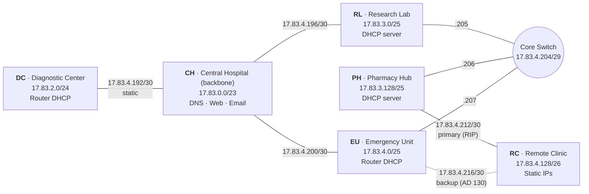

# Smart Healthcare Network Design

A multi-site enterprise network connecting six healthcare facilities, built and simulated in **Cisco Packet Tracer**. It uses **VLSM** addressing, **RIPv2** with **static-route redistribution**, all four kinds of **static routing**, **floating-static failover**, automatic **DHCP**, and its own **DNS, Web and Email** servers.

> Course project · CSE421 Computer Networks · BRAC University · April 2026

**Skills:** Cisco IOS · Routing (static + RIPv2) · VLSM/Subnetting · DHCP · DNS · SMTP/POP3 · HTTP · Network Redundancy · Packet Tracer

---

## Highlights

- Designed the topology for **6 sites and 810 end devices** around a central hospital backbone, with a shared core switch and redundant links to the remote clinic.
- Split one **/16** into **12 subnets with VLSM** (6 LANs + 6 router-to-router links) with no overlap and room left over in each block.
- Set up **next-hop, exit-interface, recursive and floating** static routes next to **RIPv2**, and used `redistribute static` so a static-only stub network can be reached from the whole RIP domain.
- Built in **automatic failover**: RIPv2 sends traffic around a broken backbone link, and a floating static route (AD 130) takes over at the remote clinic when its main RIP path (AD 120) goes down.
- Provided network services: router-based and server-based **DHCP**, a central **DNS + Web server** (`www.health.local`), and **SMTP/POP3 email** at every site, with mail tested between sites.

---

## Topology



Each site has one router and a LAN switch for its PCs and servers. The CH and EU routers use HWIC-4ESW switch modules to serve their LANs.

---

## IP Addressing (VLSM)

**Base network:** `17.83.0.0/16`, made from the last four digits of the student ID (22101**783** → 17.83). Subnets are assigned largest first, in the order the brief requires.

| Site | Devices | Prefix | Network | Gateway | Broadcast | Usable | Addressing |
|------|--------:|:------:|---------|---------|-----------|-------:|------------|
| Central Hospital (CH) | 300 | /23 | 17.83.0.0 | 17.83.0.1 | 17.83.1.255 | 510 | Static |
| Diagnostic Center (DC) | 150 | /24 | 17.83.2.0 | 17.83.2.1 | 17.83.2.255 | 254 | Router DHCP |
| Research Lab (RL) | 120 | /25 | 17.83.3.0 | 17.83.3.1 | 17.83.3.127 | 126 | DHCP server |
| Pharmacy Hub (PH) | 100 | /25 | 17.83.3.128 | 17.83.3.129 | 17.83.3.255 | 126 | DHCP server |
| Emergency Unit (EU) | 80 | /25 | 17.83.4.0 | 17.83.4.1 | 17.83.4.127 | 126 | Router DHCP |
| Remote Clinic (RC) | 60 | /26 | 17.83.4.128 | 17.83.4.129 | 17.83.4.191 | 62 | Static |

**Router-to-router links**

| Link | Subnet | Addresses |
|------|--------|-----------|
| CH ↔ DC | 17.83.4.192/30 | CH .193 · DC .194 |
| CH ↔ RL | 17.83.4.196/30 | CH .197 · RL .198 |
| CH ↔ EU | 17.83.4.200/30 | CH .201 · EU .202 |
| Core switch (RL, PH, EU) | 17.83.4.204/29 | RL .205 · PH .206 · EU .207 |
| PH ↔ RC | 17.83.4.212/30 | PH .213 · RC .214 |
| EU ↔ RC | 17.83.4.216/30 | EU .217 · RC .218 |

<details>
<summary><b>VLSM tree</b></summary>

```
17.83.0.0/16 (base network)
 ├── 17.83.0.0/23 ...... CH (300 devices, 510 usable)
 ├── 17.83.2.0/24 ...... DC (150 devices, 254 usable)
 ├── 17.83.3.0/25 ...... RL (120 devices, 126 usable)
 ├── 17.83.3.128/25 .... PH (100 devices, 126 usable)
 ├── 17.83.4.0/25 ...... EU (80 devices, 126 usable)
 ├── 17.83.4.128/26 .... RC (60 devices, 62 usable)
 └── Router-to-router links
      ├── 17.83.4.192/30 .... CH-DC
      ├── 17.83.4.196/30 .... CH-RL
      ├── 17.83.4.200/30 .... CH-EU
      ├── 17.83.4.204/29 .... Core switch (RL, PH, EU)
      ├── 17.83.4.212/30 .... PH-RC
      └── 17.83.4.216/30 .... EU-RC
```
</details>

The full per-device addressing table is in [`Project_Documentation.pdf`](Project_Documentation.pdf).

---

## Routing Design

| Router | Technique | Command |
|--------|-----------|---------|
| CH | **Next-hop static** to DC | `ip route 17.83.2.0 255.255.255.0 17.83.4.194` |
| CH | **RIPv2 + redistribute static** (advertises DC) | `router rip` → `redistribute static` |
| DC | **Default static** (stub network) | `ip route 0.0.0.0 0.0.0.0 17.83.4.193` |
| EU | **Exit-interface static** to CH | `ip route 17.83.0.0 255.255.254.0 GigabitEthernet0/0` |
| PH | **Recursive static** to DC via RL | `ip route 17.83.2.0 255.255.255.0 17.83.4.205` |
| RC | **Floating static** to CH via EU | `ip route 17.83.0.0 255.255.254.0 17.83.4.217 130` |
| CH, RL, PH, EU, RC | **RIPv2** for dynamic routing | `version 2` · `network 17.0.0.0` · `no auto-summary` |

### Redundancy & failover

| Scenario | Behavior |
|----------|----------|
| **CH ↔ RL link fails** | RIPv2 converges and sends traffic CH → EU → Core switch → RL. |
| **RC primary path (via PH) fails** | The RIP route (AD 120) is withdrawn. The floating static route via EU (AD 130) is installed automatically. |
| **PH needs to reach DC** | The recursive static route points at RL's core-switch address (17.83.4.205), and RL forwards toward CH and DC. |
| **DC (stub) connectivity** | DC needs only a default route. CH redistributes its static route to DC into RIP, so every site learns about DC. |

---

## Network Services

| Server | Address | Service | Details |
|--------|---------|---------|---------|
| CH-DNS-Web | 17.83.0.4 | DNS + HTTP | `www.health.local` → 17.83.0.4 · mail domain records |
| CH-Email | 17.83.0.5 | SMTP + POP3 | `ch.health.com` |
| RL-Email | 17.83.3.12 | SMTP + POP3 | `rl.health.com`: mail tested between CH and RL |
| DC / PH / EU / RC Email | per site | SMTP + POP3 | `dc` / `ph` / `eu` / `rc.health.com` |
| RL-DHCP | 17.83.3.2 | DHCP | GW 17.83.3.1 · DNS 17.83.0.4 |
| PH-DHCP | 17.83.3.130 | DHCP | GW 17.83.3.129 · DNS 17.83.0.4 |
| DC / EU routers | gateway | IOS DHCP | Pools `DC-POOL`, `EU-POOL` · DNS 17.83.0.4 |

---

## Router Configurations

<details>
<summary><b>CH-Router</b> (Central Hospital, backbone)</summary>

```
interface GigabitEthernet0/0
 ip address 17.83.4.193 255.255.255.252
 no shutdown
interface GigabitEthernet0/1
 ip address 17.83.4.197 255.255.255.252
 no shutdown
interface GigabitEthernet0/2
 ip address 17.83.4.201 255.255.255.252
 no shutdown
interface Vlan1
 ip address 17.83.0.1 255.255.254.0
 no shutdown
!
ip route 17.83.2.0 255.255.255.0 17.83.4.194
!
router rip
 version 2
 network 17.0.0.0
 redistribute static
 no auto-summary
```
</details>

<details>
<summary><b>DC-Router</b> (Diagnostic Center)</summary>

```
interface GigabitEthernet0/0
 ip address 17.83.4.194 255.255.255.252
 no shutdown
interface GigabitEthernet0/1
 ip address 17.83.2.1 255.255.255.0
 no shutdown
!
ip route 0.0.0.0 0.0.0.0 17.83.4.193
!
ip dhcp pool DC-POOL
 network 17.83.2.0 255.255.255.0
 default-router 17.83.2.1
 dns-server 17.83.0.4
```
</details>

<details>
<summary><b>RL-Router</b> (Research Lab)</summary>

```
interface GigabitEthernet0/0
 ip address 17.83.4.198 255.255.255.252
 no shutdown
interface GigabitEthernet0/1
 ip address 17.83.4.205 255.255.255.248
 no shutdown
interface GigabitEthernet0/2
 ip address 17.83.3.1 255.255.255.128
 no shutdown
!
router rip
 version 2
 network 17.0.0.0
 no auto-summary
```
</details>

<details>
<summary><b>PH-Router</b> (Pharmacy Hub)</summary>

```
interface GigabitEthernet0/0
 ip address 17.83.4.206 255.255.255.248
 no shutdown
interface GigabitEthernet0/1
 ip address 17.83.4.213 255.255.255.252
 no shutdown
interface GigabitEthernet0/2
 ip address 17.83.3.129 255.255.255.128
 no shutdown
!
ip route 17.83.2.0 255.255.255.0 17.83.4.205
!
router rip
 version 2
 network 17.0.0.0
 no auto-summary
```
</details>

<details>
<summary><b>EU-Router</b> (Emergency Unit)</summary>

```
interface GigabitEthernet0/0
 ip address 17.83.4.202 255.255.255.252
 no shutdown
interface GigabitEthernet0/1
 ip address 17.83.4.207 255.255.255.248
 no shutdown
interface GigabitEthernet0/2
 ip address 17.83.4.217 255.255.255.252
 no shutdown
interface Vlan1
 ip address 17.83.4.1 255.255.255.128
 no shutdown
!
ip route 17.83.0.0 255.255.254.0 GigabitEthernet0/0
!
router rip
 version 2
 network 17.0.0.0
 no auto-summary
!
ip dhcp pool EU-POOL
 network 17.83.4.0 255.255.255.128
 default-router 17.83.4.1
 dns-server 17.83.0.4
```
</details>

<details>
<summary><b>RC-Router</b> (Remote Clinic)</summary>

```
interface GigabitEthernet0/0
 ip address 17.83.4.214 255.255.255.252
 no shutdown
interface GigabitEthernet0/1
 ip address 17.83.4.218 255.255.255.252
 no shutdown
interface GigabitEthernet0/2
 ip address 17.83.4.129 255.255.255.192
 no shutdown
!
ip route 17.83.0.0 255.255.254.0 17.83.4.217 130
!
router rip
 version 2
 network 17.0.0.0
 no auto-summary
```
</details>

---

## Run & Verify

1. Open [`Smart_Healthcare_Network.pkt`](Smart_Healthcare_Network.pkt) in [Cisco Packet Tracer](https://www.netacad.com/cisco-packet-tracer).
2. Check the routing tables: `show ip route` and `show ip protocols` on any router.
3. Test reachability: ping and tracert between PCs at different sites. Browse `http://www.health.local` from any PC.
4. Test failover:
   - `shutdown` CH Gig0/1 (CH ↔ RL) → traffic to RL now goes through EU.
   - `shutdown` RC Gig0/0 (RC ↔ PH) → `show ip route` on RC shows the AD-130 static route via EU.
5. Test email: send mail from a CH user to an RL user with the Packet Tracer email client.

---

## Files

| File | Description |
|------|-------------|
| [`Smart_Healthcare_Network.pkt`](Smart_Healthcare_Network.pkt) | Packet Tracer simulation |
| [`Project_Documentation.pdf`](Project_Documentation.pdf) | Full report: VLSM, addressing table, DHCP, servers, configs, redundancy |
| [`Project_Documentation.docx`](Project_Documentation.docx) | Editable source of the report |
| [`Project_Requirements.pdf`](Project_Requirements.pdf) | Original project brief |
